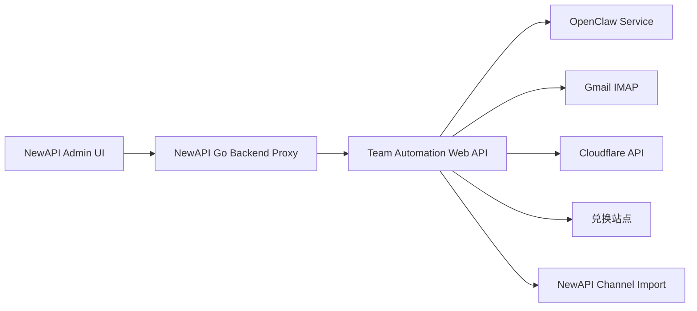

# Team Automation → NewAPI 原生适配说明（2026-04-12）

## 1. 绝对真实边界

本次交付**不是**把 Python Team Automation / OpenClaw 重写进 NewAPI Go 进程。

本次实际完成的是：

- 在 **NewAPI 官方源码** 中新增一个**原生管理入口**；
- 新增一个 **Team Automation 连接器设置页**；
- 新增一组 **NewAPI 后端代理 API**，把 NewAPI 后台操作转发到外部 Team Automation 服务；
- 支持在 NewAPI 后台内完成：
  - 远端连接配置
  - 连接测试
  - 执行任务发起
  - 任务历史查看
  - 任务详情 / 日志查看
  - 账号列表 / 账号统计查看
  - 单个账号新增
  - 账号详情查看
  - 账号状态编辑
  - 账号删除
  - CSV 导入 / 导出

当前最真实、最可落地的部署形态仍然是：

- **NewAPI**：统一管理面板与权限入口；
- **Team Automation / OpenClaw**：继续运行在另一台服务器；
- **NewAPI 通过可插拔连接器访问 Team Automation**；
- **OpenClaw 仍然保持外置、可远端化、可不启用**。

## 2. 为什么采用这种架构

你已经明确：

- NewAPI 在另一台服务器；
- OpenClaw 在当前服务器；
- 当前需求是 **分析官方 NewAPI 源码并做原生功能适配**，不是在本机重写一套新的 Go 自动化执行器。

所以最符合真实部署形态的方案不是“伪原生重写”，而是：

1. **NewAPI 原生提供管理入口**；
2. **敏感连接配置保留在 NewAPI Options**；
3. **执行能力继续由远端 Team Automation 服务承担**；
4. **OpenClaw 保持可插拔、可远端部署、可后期开公网**。

## 3. 已完成的源码改动

### 3.1 后端

新增：

- `controller/team_automation.go`
- `controller/team_automation_test.go`
- `service/team_automation.go`
- `service/team_automation_test.go`

修改：

- `model/option.go`
- `router/api-router.go`

新增的 NewAPI Option 键：

- `TeamAutomationEnabled`
- `TeamAutomationBaseURL`
- `TeamAutomationUsername`
- `TeamAutomationPasswordSecret`
- `TeamAutomationTimeoutSeconds`
- `TeamAutomationVerifySSLEnabled`

后端现已增加额外约束：

- `TeamAutomationBaseURL` 必须是 `http://` 或 `https://`
- `TeamAutomationTimeoutSeconds` 必须在 `5~300` 之间

### 3.2 前端

新增：

- `web/src/components/settings/TeamAutomationSetting.jsx`
- `web/src/helpers/teamAutomation.js`
- `web/src/helpers/lobeIconsRegistry.js`
- `web/src/pages/TeamAutomation/index.jsx`
- `web/src/pages/TeamAutomation/useTeamAutomationPage.js`
- `web/src/pages/TeamAutomation/sections.jsx`
- `web/src/pages/TeamAutomation/AccountModal.jsx`
- `web/src/pages/TeamAutomation/constants.js`
- `web/src/pages/TeamAutomation/utils.jsx`

修改：

- `web/src/App.jsx`
- `web/src/components/layout/SiderBar.jsx`
- `web/src/hooks/common/useSidebar.js`
- `web/src/helpers/index.js`
- `web/src/helpers/lobeIconsRegistry.js`
- `web/src/pages/Home/index.jsx`
- `web/src/helpers/render.jsx`
- `web/src/pages/Setting/index.jsx`
- `web/src/pages/Setting/Operation/SettingsSidebarModulesAdmin.jsx`
- `web/src/components/settings/personal/cards/NotificationSettings.jsx`
- `web/package.json`
- `web/vite.config.js`

### 3.3 工程化脚本

新增：

- `scripts/team-automation-adapter-smoke.sh`

用途：

- 运行 Team Automation 相关 Go 测试；
- 运行前端 esbuild 级别 smoke check；
- 明确提示“full build / remote deployment 仍是独立任务”。

## 4. 新增的 NewAPI 代理接口

### Root 权限

- `GET /api/team-automation/settings`
- `POST /api/team-automation/settings/test-connection`

### Admin 权限

- `GET /api/team-automation/health`
- `GET /api/team-automation/stats`
- `GET /api/team-automation/cache/stats`
- `GET /api/team-automation/accounts`
- `POST /api/team-automation/accounts`
- `GET /api/team-automation/accounts/stats`
- `GET /api/team-automation/accounts/export/csv`
- `POST /api/team-automation/accounts/import/csv`
- `GET /api/team-automation/accounts/:email`
- `PUT /api/team-automation/accounts/:email`
- `DELETE /api/team-automation/accounts/:email`
- `POST /api/team-automation/run`
- `GET /api/team-automation/run/history`
- `GET /api/team-automation/run/:id`
- `GET /api/team-automation/run/:id/logs`
- `POST /api/team-automation/run/:id/stop`

## 5. 原生页面入口

### Root 设置页

路径：

- `控制台 -> 系统设置 -> Team 自动化连接器`

能力：

- 启用 / 禁用连接器
- 配置远端 Base URL
- Basic Auth 用户名 / 密码
- TLS 校验开关
- 超时配置
- 保存前基础参数校验（URL / 超时范围）
- 测试连接
- 密码保留 / 清空逻辑

### Admin 页面

路径：

- `控制台 -> Team 自动化`

能力：

- 远端任务控制台
- 统计数据
- 健康检查结果
- 缓存状态展示
- 启动任务
- 停止任务
- 执行历史
- 执行详情
- 执行日志
- 账号列表
- 单账号创建
- 账号详情查看
- 账号状态编辑
- 账号删除
- CSV 导入（前端增加文件类型 / 文件大小校验）
- CSV 导出（当前页面筛选条件会在 NewAPI 侧再次过滤导出结果）

工程化优化：

- Team Automation 管理页面已从单文件拆分为：状态 hook、展示 section、账号弹窗、常量、显示工具；
- 原 1310 行页面已拆成：
  - `index.jsx` 180 行
  - `useTeamAutomationPage.js` 648 行
  - `sections.jsx` 484 行
  - `AccountModal.jsx` 190 行
- 新增 smoke script，便于移植前先跑最小验证闭环。

## 6. OpenClaw 可插拔架构



### 结论

- OpenClaw **不直接耦合到 NewAPI 进程**；
- 未来你把 NewAPI 放公网、Team Automation / OpenClaw 放另一台机器时，当前方案依然成立；
- 你只需要把 `TeamAutomationBaseURL` 指向远端 Team Automation 服务即可；
- 当你暂时不想启用 OpenClaw 时，只需在 Team Automation 远端层面不启用对应链路，NewAPI 本身无需改代码。

## 7. 已完成验证

### 7.1 Go 侧

已执行并通过：

```bash
cd /root/work/new-api-official
go test ./service -run TeamAutomation -count=1
go test ./controller ./service -run TeamAutomation -count=1
./scripts/team-automation-adapter-smoke.sh
```

额外新增并通过的控制器测试覆盖：

- CSV 导出文件返回
- CSV 导出本地筛选
- CSV 导出缺列报错
- CSV 导入 multipart 转发
- CSV 导入缺失文件报错
- 配置响应不泄漏密码

### 7.2 仓库级空跑测试（真实结果）

执行：

```bash
cd /root/work/new-api-official
go test ./... -run '^$' -count=1
```

真实结果：**未完全通过**。

失败点：仓库根包 `main.go` 依赖 `web/dist` 静态产物；当前工作区尚未生成该目录，因此报错：

```text
main.go:37:12: pattern web/dist: no matching files found
```

### 7.3 前端语法 / bundle 级验证

已执行并通过：

```bash
cd /root/work/new-api-official/web
npx esbuild \
  src/pages/TeamAutomation/index.jsx \
  src/components/settings/TeamAutomationSetting.jsx \
  src/helpers/teamAutomation.js \
  --bundle --format=esm --external:* --outdir=/tmp/newapi-team-automation-smoke
```

### 7.4 前端完整生产构建验证（真实结果）

我没有伪造“前端已全量构建通过”的结论。当前真实情况是：

1. 依赖树冲突已通过 `npm install --legacy-peer-deps` 处理；
2. `@douyinfe/semi-ui/dist/css/semi.css` 的 exports 问题已通过 `vite.config.js` alias 规避；
3. `@lobehub/icons` 对 `antd` 的运行时依赖已补齐；
4. 已将 `code-inspector-plugin` 限制为仅 dev 使用，避免 production build 注入无关插件；
5. 已将 `@lobehub/icons` 的根入口导入改为本地生成的深导入注册表 `web/src/helpers/lobeIconsRegistry.js`，避免继续从包根入口拉入整包；
6. 已为 `@visactor/*` 增加独立 manual chunk；
7. 但 **`npm run build` 仍未在当前环境完成**。

最新一次实际执行：

```bash
cd /root/work/new-api-official/web
npm run build
```

真实现象：

- 进入 `vite build`；
- 输出 `transforming...`；
- 在当前环境中进入长时间 `transforming...`；
- 最新一次完整尝试最终被系统以 **退出码 137 (`Killed`)** 终止；
- 结合当时进程观测，Node RSS 约 **2.08 GiB**，主机可用内存与 swap 均非常紧张；
- 因此 **当前不能诚实宣称 `web/dist` 已成功产出**。

## 8. 当前仍然存在的限制

### P0 / 无法诚实忽略的限制

1. **未在你的远端 NewAPI 实例完成真实部署**
   - 这里只改了本地源码；
   - 你还需要手工移植到远端服务器。

2. **未完成“远端真实 E2E / Playwright / 多机联调”**
   - 当前环境无法访问你另一台服务器上的正式 NewAPI 部署；
   - 当前也没有你后续准备开放的公网 Team Automation 地址。

3. **前端完整生产构建在当前机器仍未跑通**
   - Team Automation 新增页面已经通过 esbuild 语法 / bundle 级验证；
   - 但仓库级 Vite 生产构建仍未在当前环境完成。

### P1 / 功能层限制

1. 当前原生页面已经补齐：
   - 账号新增
   - 账号详情
   - 账号状态编辑
   - 账号删除
   - CSV 导入
   - CSV 导出
2. **未补齐的仍然是“任务暂停 / 任务删除 / 历史清理”这类能力**；
3. 根因不是 NewAPI 这侧没写，而是远端 Team Automation API 当前只提供：
   - 启动任务
   - 查询任务
   - 查询日志
   - 停止任务
4. 如果你要在 NewAPI 中继续原生暴露“暂停 / 删除任务”按钮，必须先扩展远端 Team Automation API。

## 9. 远端移植建议

### 9.1 后端

复制这些文件到你的远端 NewAPI 对应位置：

- `controller/team_automation.go`
- `controller/team_automation_test.go`
- `service/team_automation.go`
- `service/team_automation_test.go`
- `model/option.go`
- `router/api-router.go`

### 9.2 前端

复制这些文件到远端：

- `web/src/components/settings/TeamAutomationSetting.jsx`
- `web/src/helpers/teamAutomation.js`
- `web/src/helpers/lobeIconsRegistry.js`
- `web/src/pages/TeamAutomation/index.jsx`
- `web/src/pages/TeamAutomation/useTeamAutomationPage.js`
- `web/src/pages/TeamAutomation/sections.jsx`
- `web/src/pages/TeamAutomation/AccountModal.jsx`
- `web/src/pages/TeamAutomation/constants.js`
- `web/src/pages/TeamAutomation/utils.jsx`
- `web/src/App.jsx`
- `web/src/components/layout/SiderBar.jsx`
- `web/src/hooks/common/useSidebar.js`
- `web/src/helpers/index.js`
- `web/src/helpers/lobeIconsRegistry.js`
- `web/src/pages/Home/index.jsx`
- `web/src/helpers/render.jsx`
- `web/src/pages/Setting/index.jsx`
- `web/src/pages/Setting/Operation/SettingsSidebarModulesAdmin.jsx`
- `web/src/components/settings/personal/cards/NotificationSettings.jsx`
- `web/package.json`
- `web/vite.config.js`

### 9.3 文档与脚本

- `docs/TEAM_AUTOMATION_NEWAPI_ADAPTER_20260412.md`
- `docs/TEAM_AUTOMATION_MIGRATION_CHECKLIST_20260412.md`
- `scripts/team-automation-adapter-smoke.sh`

### 9.4 远端构建建议

在你远端机器上至少保证：

- Node.js 18+
- 可用内存 >= 4 GB（更稳妥建议 6~8 GB）

建议命令：

```bash
cd web
npm install --legacy-peer-deps
NODE_OPTIONS=--max-old-space-size=4096 npm run build
```

## 10. 推荐的公网开放方式

当前不建议你直接把 OpenClaw 暴露给公网。

更稳妥的做法：

1. 只暴露 **Team Automation Web API**；
2. Team Automation 内部再访问 OpenClaw；
3. 在 Team Automation 层做：
   - Basic Auth
   - TLS
   - IP 白名单
   - 反向代理限流
4. NewAPI 只保存 Team Automation 连接器配置。

这就是目前最适合你“NewAPI 与 OpenClaw 分机部署”的形态。
